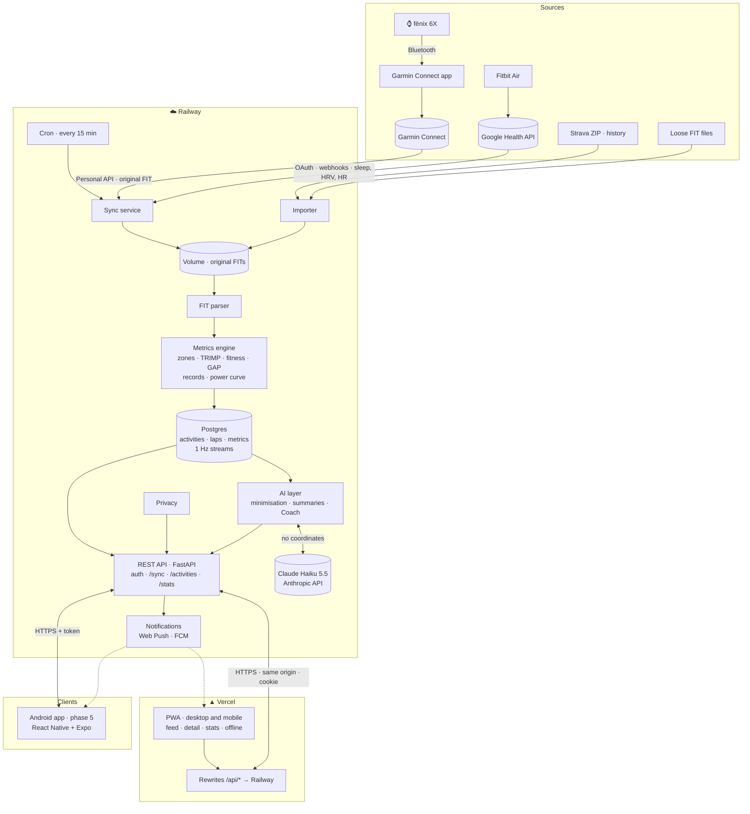
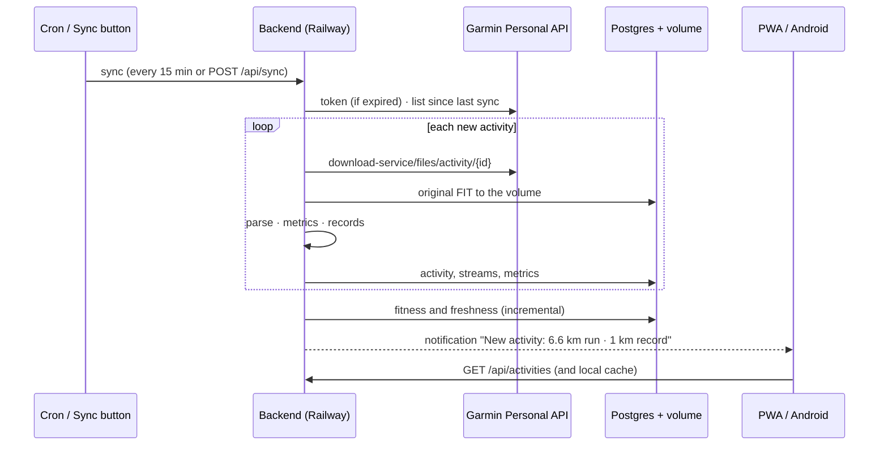

# Zankup architecture (v1)

A **personal, open source and self-hosted**, Strava-like platform: it syncs Garmin activities automatically, keeps the original FIT files and shows them with a map, laps and **its own advanced metrics** (what Strava charges for in Premium). There are two clients: first a **PWA for desktop and mobile, hosted on Vercel**, and later a **native Android app**. Both use the same backend, which runs on Railway.

Visual map: [architecture.html](architecture.html) · Why this architecture: [findings.md](findings.md)

## Principles

1. **The original FIT is the source of truth.** It is stored as is and never modified. Everything else can be recomputed from it.
2. **API first.** The backend exposes a REST API shared by the PWA and the Android app. No business logic lives in the clients.
3. **A TypeScript monorepo for the clients.** The PWA (React) and the Android app (React Native + Expo) share a `core` package with the API client, data hooks, formatting logic, design tokens and translations.
4. **Always available.** The backend runs in the cloud (Railway): it syncs on its own and sends notifications even when the PC is off.
5. **Private by default.** A single user per instance, everything behind authentication, no public profiles. Privacy zones apply to anything shared.
6. **Only official channels for automation:** the Garmin Personal API. Manual files (Strava ZIP, loose FITs) come in through an importer.
7. **Our own metrics.** Zones, load, fitness and records are computed with Zankup's settings, not the watch's.
8. **English by default, Spanish available.** Every user-facing text goes through i18n from day one (see [Internationalisation](#internationalisation-i18n)).
9. **Open source and self-hosted.** Each person deploys their own instance with their own keys (see [Product model](#product-model)).

## Product model

- **Self-hosted, bring your own keys.** There is no central Zankup service. Each person deploys an instance (Railway + Vercel, or `docker compose` on their own server) and configures their own Garmin Personal API key, Google OAuth client, Resend account, Google Health client and, optionally, Anthropic key. This keeps every instance within the Personal API's personal-use terms and keeps health data with its owner. Setup guide: `docs/self-hosting.md` (OS-224).
- **Optional integrations degrade gracefully:** without an Anthropic key the AI features are hidden; without a Google client there is no Google sign-in or Google Health; the core (Garmin sync, metrics, PWA) only needs the Garmin key.
- **Licences:** `packages/metrics` is MIT (a reusable metrics library); the backend, the PWA and the app are AGPL-3.0.
- **No payments.** Every user-owned table has `user_id` and every query filters by it, so a hosted multi-user version stays possible without a migration, but nothing else (billing, plans, quotas) is built.
- **URLs:** the reference instance is **zankup.com** (PWA and `/api` proxy, Vercel; `www` redirects to it) and **api.zankup.com** (the API on Railway, used directly by the Android app). A self-hosted instance works on its `*.vercel.app` and `*.up.railway.app` URLs, or on its own domain with the same three records.

  | Record | Name | Value | For |
  |---|---|---|---|
  | A | `@` | Vercel's IPs (the project's domain settings show them) | the PWA |
  | CNAME | `www` | the project's `vercel-dns` target | redirect to the apex |
  | CNAME | `api` | the service's `*.up.railway.app` target | the API |
  | TXT | `_railway-verify.api` | the token Railway shows | proves ownership to Railway |

  Remove the registrar's parking records: a leftover `A @ Parked` sends part of the visits to the registrar's page. Passkeys are bound to this domain (OS-405), so it must not change once they are in use.

## Diagram



## Deployment: Railway

| Piece | On Railway | Notes |
|---|---|---|
| **API** | Web service (FastAPI + Uvicorn) | API only: the PWA is on Vercel. HTTPS and domain included |
| **Scheduled sync** | A scheduler thread in the API queues a `sync_garmin` job every 15 min (`SYNC_INTERVAL_MINUTES`), one per time slot | Not a Railway Cron Job: it would not see the volume with the FIT files. Also by hand with the "Sync" button (`POST /api/sync`) or `python -m zankup.sync` |
| **Database** | Managed Postgres | Private-network connection. 1 Hz streams go in compressed `jsonb` or `bytea` columns |
| **Backups** | Bucket `backups` (S3-compatible, Amsterdam) in the same project | Daily `pg_dump` + the original FITs, see "Backups and alerts" below |
| **Original FITs** | Persistent volume mounted at `/data/raw` | A few MB per year (about 50–120 KB per activity). Can be copied elsewhere |
| **Secrets** | Railway environment variables | `GARMIN_PERSONAL_API_KEY`, `JWT_SECRET`, `VAPID_*`, `FCM_*`, `RESEND_API_KEY` |

**How the `api` service is configured (production):**
- **Deploys** from `main` through a GitHub deployment trigger with "wait for CI": a commit deploys only after its checks pass. The Railway GitHub app needs access to the repository for that trigger.
- **Build:** `backend/Dockerfile` (path set on the service). **Pre-deploy:** `alembic -c backend/alembic.ini upgrade head`, so a failing migration stops the deploy and the running version stays up. **Health check:** `/api/health`, which also reports the database and the applied migration (`schema_revision`).
- **Background jobs** (OS-115) run in a worker thread inside the API process, on a `jobs` table claimed with `FOR UPDATE SKIP LOCKED`. Not a separate service because a Railway volume attaches to one service only, and the worker needs the original FIT files on `/data`. `RUN_WORKER=false` turns it off; `python -m zankup.jobs.worker` runs it on its own (self-hosting on one machine, or a future setup with object storage).
- **Railway treats `railway.json` (config as code) as deprecated** and does not apply every field from it: the pre-deploy command in the file was ignored until it was set on the service itself through the API. The service settings are the source of truth; `railway.json` stays only as documentation of them and must be kept in sync by hand. The self-hosting kit (OS-224) will set these settings by script.

### Backups and alerts (OS-114)

- **Logs:** JSON lines on stdout (`LOG_FORMAT=json` in production), searchable in Railway's log view: every sync, job, import and failure carries its IDs as fields.
- **Sync alert:** an e-mail through Resend at the **third failed sync in a row**, and another when it works again. A long outage is one e-mail, not one every 15 minutes. `ALERT_EMAIL` sets the recipient; without `RESEND_API_KEY` alerts are only logged.
- **Daily backup** (a `backup` job queued by the scheduler for `BACKUP_HOUR_UTC`, 03:00 by default): `pg_dump --format=custom` of the whole database to `db/zankup-YYYY-MM-DD.dump` (the last 30 are kept), the original FITs to `raw/` (immutable, so each is uploaded once and kept for good) and `latest.json` with the newest dump and its SHA-256. A backup that fails three times e-mails the owner. Nothing else needs backing up: streams and metrics are in the database or recomputed from the FITs.
- **Where:** a Railway bucket in the same project, whose credentials reach the `api` service as variable references (`BACKUP_S3_*` = `${{backups.*}}`). It is a different storage system from the volumes, though the same provider: for copies outside Railway, point `BACKUP_S3_*` at Cloudflare R2 or Backblaze B2. Railway's own volume snapshots need the Pro plan and are not used.
- **Restore** (tested in CI, and against the production bucket into a fresh database and data folder):

  ```bash
  /app/.venv/bin/python -m zankup.backup list       # on Railway, through railway ssh
  /app/.venv/bin/python -m zankup.backup restore --database-url postgresql://… --data-dir /data [--date YYYY-MM-DD]
  ```

  It drops and recreates every table in the target database, checks the dump against `latest.json` and copies back the FITs that are missing. To restore production: create a new Postgres, restore into it, point the `api` service's `DATABASE_URL` at it and run the restore command in the `api` service for `/data`.

**Why Railway?** It deploys straight from git, offers Postgres, volumes and cron in the same project, and costs about $5/month for this usage.

**Alternatives:**
- **Fly.io:** similar, with volumes and Postgres.
- **Hetzner VPS:** about €4/month, full control, but maintenance is on you.
- **Home server on Tailscale:** data never leaves home, but the machine has to be always on.

The application is packaged as a container (Dockerfile) so the provider can be changed without touching code.

## Deployment: Vercel (PWA)

| Piece | On Vercel | Notes |
|---|---|---|
| **PWA** | Static project (Vite build), connected to the repository | **Only `main` deploys** (`git.deploymentEnabled`): previews cost build minutes, and every PR is already built and tested end to end in CI |
| **API proxy** | `vercel.json` → `rewrites: [{ "source": "/api/:path*", "destination": "https://<api>.up.railway.app/api/:path*" }]` | The PWA calls `/api/...` on its own origin: **no CORS**, `httpOnly` and `SameSite=Strict` cookies, and it also works on previews |
| **Variables** | None | No secrets on Vercel: they all live on Railway. The VAPID public key is fetched from the API |

**Why the proxy instead of calling Railway directly:** if each part were on a different domain, CORS would be needed, cookies would be cross-site (which browsers block more and more) and Vercel previews would not have a fixed origin. With rewrites, the browser only talks to Vercel.

**Cost of the proxy:** Vercel limits the duration of proxied requests, so sync progress is polled every 2 s (`GET /api/sync/{id}`) instead of keeping an SSE connection open. The Android app talks to Railway directly, with tokens.

**Large files skip the proxy (phase 4):** imports (a Strava export is hundreds of megabytes) and data exports go straight to the API host (`API_PUBLIC_URL`, e.g. `https://api.zankup.com`). The app asks for them through the proxy as usual and gets a short-lived signed URL; the bytes then travel browser ↔ Railway, in 4 MB parts for uploads, without cookies (CORS allows only the app's origins, `GET` and `PUT`). This avoids the proxy's request size limit and Vercel's data transfer bill. Without `API_PUBLIC_URL` the same URLs go through the proxy, which still works.

**Alternative if ever needed:** a custom domain with `app.` on Vercel and `api.` on Railway. They count as the same site for cookies, so `SameSite=Lax` with CORS restricted to `app.` would work.

**What being in the cloud implies:** your location and health data live with a third party (Railway) and the service is exposed to the internet. That is why authentication is mandatory from day one and nothing is public by default.

## Components

| Component | Responsibility | Status |
|---|---|---|
| **Sync service** | Key → 24 h token → new activities → ZIP → FIT. Triggered by cron or by the button | ✅ Prototype in `backend/garmin_sync.py` |
| **Importer** | Loose FITs, Garmin ZIP and Strava bulk ZIP for history. Deduplicates by start time and device | Pending |
| **FIT parser** | FIT → session, laps, 1 Hz streams, device and power | ✅ Logic tested |
| **Metrics engine** | See "Advanced metrics" | Partial: exact best efforts |
| **Historical computation engine** | Job queue in Postgres and a worker on Railway. Processes history incrementally, with versioned full recomputation. Produces estimates, curves, progress and events | Done (phase 3): `backend/src/zankup/engine` |
| **REST API** | FastAPI, OpenAPI generated automatically. Used by the PWA and Android | Pending |
| **Authentication** | One user per instance: sign-in with password + TOTP, a **passkey** (WebAuthn, bound to the instance's domain; it replaces both password and code because the device checks the fingerprint, face or PIN) or a **Google account** (OpenID Connect, only the linked account). The PWA uses an `httpOnly` session cookie (same origin, thanks to the Vercel proxy). Android uses a short access token and a long refresh token. Devices can be revoked | Password + TOTP and passkeys done (OS-110, OS-405 backend); Google pending |
| **Sign-up and recovery** | One-time initial sign-up at `/setup`, protected by a **setup code** that the server writes to its logs on every start while there is no account: name, e-mail and password (12+ characters, checked against Have I Been Pwned by k-anonymity), TOTP with a QR code, and 8 single-use recovery codes that replace the TOTP code at sign-in. Sign-up closes for good once TOTP is on, and it takes over the owner account so already-synced activities stay. Recovery by email with a single-use link (30 min) that also requires the TOTP code or a recovery code | Sign-up done (OS-221); recovery pending (OS-222) |
| **Transactional email** | Resend, one account per instance (the test sender delivers to the owner's address, so no custom domain is required): recovery links, security alerts (password changed, new sign-in) and an optional weekly report, in the user's language | Pending |
| **Google Health connector** | Google OAuth and Google Health API webhooks (Fitbit Air): sleep with stages, HRV, resting HR, SpO₂. Priority rules between sources | Phase 6 |
| **AI layer** | Minimised context (no coordinates or profile data), per-activity summaries, weekly report (batched) and a Coach with tools over our API | Phase 7 |
| **Notifications** | Web Push with VAPID for the PWA and FCM for Android: new activity, record, sync failure, key about to expire | Pending |
| **Privacy** | Privacy zones (centre and radius) applied when serving or exporting anything shareable | Pending |
| **Internationalisation** | English by default, Spanish selectable. Shared catalogues, locale-aware formatting, server-side texts in the user's language | Pending |
| **PWA** | See "Clients" | Prototype |
| **Android app** | React Native + Expo. See "Clients" | Proof of concept at the start of phase 2, the app in phase 5 |

## Advanced metrics (Strava's "Premium", built by us)

| Metric | Computation | Data source |
|---|---|---|
| **HR and pace zones** | Time in zones using the max/resting HR or threshold configured in Zankup (not the watch's) | 1 Hz HR and speed |
| **Relative effort** | Banister TRIMP (or Edwards by zones) per activity | 1 Hz HR and resting/max HR |
| **Fitness and freshness** | Fitness (CTL, 42-day exponential average), Fatigue (ATL, 7-day) and Form (TSB = CTL − ATL) from daily effort | Relative effort |
| **Grade-adjusted pace (GAP)** | Pace corrected for gradient (Minetti model) | Barometric altitude and distance |
| **Records and their progression** | Best efforts (400 m … marathon) per activity, all-time and per-season personal records | Cumulative distance |
| **Race prediction** | Riegel from recent best efforts | Best efforts |
| **Power curve** | Best average power for each duration (5 s … 60 min) on rides and indoor rides (ROUVY) | 1 Hz power |
| **Matched routes** | Group activities by route similarity and compare times (Strava's "Matched Runs") | Simplified GPS track |
| **Personal heatmap** | Density of all routes | GPS from every activity |
| **Volume and trends** | Distance, time, elevation and load per week, month and year, per sport | Summaries |
| **Garmin-only data** | Training Effect, load, HRV and sleep (later phase) | FIT and Personal API |

They are computed when each activity is imported. Daily metrics (fitness and freshness) are recomputed incrementally. All of this is produced by the historical computation engine described next.

## Historical computation engine ("cooking" the data)

Like Strava, Zankup computes nothing heavy when you open a screen. A **background engine processes the whole history** and prepares the tables of metrics, estimates and progress. Screens only read precomputed results, so they open instantly even with thousands of activities.

### What it produces

| Family | Examples | How it is estimated |
|---|---|---|
| **Per activity** | Splits, best efforts (distance and duration), zones, TRIMP, GAP, normalised power, HR/pace decoupling | From the 1 Hz streams |
| **Best-effort curves** | Pace and power for each duration (5 s … 2 h), per period (last 42 days, 90 days, season, all time) | Maximums of the per-activity curves |
| **Performance estimates** | Estimated FTP, threshold and critical pace, threshold HR (LTHR), observed max HR, estimated VO₂max (VDOT), 5K, 10K, half and marathon predictions | FTP ≈ 95% of the best 20 min or a critical power model. Critical pace from 3–30 min efforts. Daniels' VDOT and Riegel from recent best efforts. LTHR from average HR of 20–60 min efforts |
| **Load and fitness** | Daily TRIMP, fitness, fatigue and form, weekly ramp (overload risk), monotony | Daily series with exponential averages |
| **Progress** | Records and their progression, comparison with the same week or month last year, trend of each estimate, aerobic efficiency (pace at equal HR), matched routes getting faster | Time series from the tables above |
| **Goals and streaks** | Km or hours per week, month or year, streaks of active weeks, end-of-month projection | Per-period aggregates |
| **Health** (phase 6) | Trend of HRV, resting HR and sleep, "readiness" combined with form | Daily data from Garmin and Google Health |

Every estimate stores **value, date, method, source activities and confidence**, so the app can explain where each number comes from ("Estimated FTP 205 W, from your best 20 min on 12 October").

### How it works

```mermaid
flowchart LR
  NEW[New activity<br/>or health data] --> Q[(Job queue<br/>Postgres)]
  CFG[Settings change<br/>max HR, zones, FTP] --> Q
  VER[New version<br/>of an algorithm] --> Q
  Q --> W[Worker<br/>Railway]
  W --> A1[1 · Activity metrics]
  A1 --> A2[2 · Affected days<br/>load, fitness]
  A2 --> A3[3 · Curves and records<br/>per period]
  A3 --> A4[4 · Estimates<br/>and predictions]
  A4 --> A5[5 · Progress,<br/>goals, streaks]
  A5 --> EV[Events<br/>"new record", "FTP up"]
  EV --> N[Notifications · AI]
```

- **Incremental by default:** a new activity only recomputes what depends on it: its own record, the days from its date onwards (fitness carries forward), the curves of the periods that include it and the estimates that use it. A few seconds per activity.
- **Full recomputation in the background:** when settings change (max HR, zones, FTP) or an algorithm version changes, the whole history is reprocessed from the original FITs without blocking the app, which shows a "recomputing" notice.
- **Versioning:** every computed table carries `metrics_version`. Improving an algorithm means bumping the version and triggering the recomputation, with no manual migrations.
- **Idempotent and reproducible:** running it twice gives the same result, and everything can be regenerated from the original FITs.
- **Queue in Postgres** (no new services), run by a **worker** on Railway. It is the same container as the API, started in worker mode.
- **Output events:** "new 5K record", "your estimated FTP rises to 210 W" or "high load ramp this week". They feed notifications and the AI layer.

**As built (phase 3):**
- Jobs: `metrics_activity` (queued by every import: the activity's metrics, record events and segment efforts), `metrics_user` (one per burst of imports, five seconds later: daily load and form, estimates, matched routes, the ramp event), `metrics_full` (every activity again with an `engine_runs` row for progress, then the user level) and `segment_search` (a new segment against the whole history). `metrics_full` runs on the worker for long jobs.
- Tables: `activity_metrics` (TRIMP, zones, curves as JSON per duration, GAP distance, estimated calories, efficiency, decoupling, matched route), `daily_load`, `estimates` (one row per kind and day, with the method as a key the app words and the source activities), `events`, `goals`, `segments`, `segment_efforts`, `engine_runs`.
- Period curves are the maximum, per duration, of the per-activity curves in the period: a few thousand small JSON rows read in milliseconds.
- `METRICS_VERSION` lives in `zankup.engine`. On start, users with activities the current version has not computed get a full recomputation. Changing max or resting HR, the zone model, LTHR or FTP, or the profile's age, sex or weight, queues one too.
- Assumptions while a setting is missing: resting HR 60, max HR the highest recorded (else 190), TRIMP coefficients averaged between men and women when sex is not set.
- Decoupling is pace against HR (Pa:HR) for runs and walks, and power against HR (Pw:HR) for rides with power; it is not computed for rides without power.

## History, privacy and sharing (phase 4, as built)

- **Imports** (`importer.py`, `api/transfers.py`): an upload is a FIT, TCX or GPX (gzipped or not) or a ZIP. A ZIP with `activities.csv` is a Strava export; any other is searched for activity files, including nested ZIPs (Garmin's export). The `import_upload` job runs on the long-jobs worker, one transaction per activity, recording progress on `imports`; an interrupted import resumes where it was.
  - Strava rows match an activity Garmin already has by start time (±2 min): Garmin's FIT stays and gets Strava's name, description, gear, photos and weather. Otherwise the file is imported (`source = 'strava'`), or, without a file, the activity is created from the CSV totals. Strava's Relative Effort, calories and grade-adjusted distance are kept in `activities.strava` as references (OS-323).
  - When Garmin later sends an activity that came from Strava or a file, Garmin's FIT takes it over (`ingest.py`).
  - TCX/GPX distance comes from smoothed positions when the file has none (no best efforts from it); elevation gain from smoothed altitude with a 1 m hysteresis (`fit/xml.py`).
- **Edits** (`PATCH /api/activities/{id}`) never touch the original: edited fields are listed in `edited_fields`, and reprocessing and imports keep them.
- **Gear** (`gear`, `activities.gear_id`): mileage is the sum of its activities plus `initial_m`; shoes warn at 800 km by default. New activities from the sync get the default gear of their sport; imports keep Strava's (or none).
- **Photos** (`photos`, `photos.py`): re-encoded on arrival (upright, at most 2048 px, JPEG) without any metadata, so no photo can reveal where it was taken; a 480 px thumbnail for the feed. Stored under `DATA_DIR/photos`.
- **Privacy zones** (`settings.privacy_zones`, `privacy.py`): circles of 100 m to 5 km (+60 m so a route does not trace the edge). Anything shareable drops the points inside and splits the route there. Imported from Strava's `privacy_zones.csv` when none are set.
- **Sharing** (`share_links`, `api/sharing.py`): `/s/<token>`, 32 random bytes of which only the SHA-256 is stored, expiring after 1–365 days or when revoked. It shows the summary, splits, an elevation profile, photos and, if chosen, the trimmed route; never HR series, the file, the device or the time of day. Share images are drawn in the browser from the same trimmed data.
- **Notifications** (`push_subscriptions`, `notify.py`): Web Push implemented with `cryptography` (aes128gcm, RFC 8291) and `pyjwt` (VAPID, RFC 8292). The VAPID key is `VAPID_PRIVATE_KEY` or one generated once on the data volume. Kinds: new activity and record (only for recent activities, never a backfill), sync failing (the third failure in a row), Garmin key expiring (14 days before), estimate up (off by default) and import finished. Each is a `push` job, in the user's language; dead subscriptions are dropped.
- **Export** (`exporter.py`): a ZIP with every original, the series, photos and JSON for everything else, kept seven days under `DATA_DIR/exports`.
- **Review** (`GET /api/stats/review`): a month or a year from the precomputed tables. **Comparison with Strava** (`GET /api/stats/strava-comparison`): R², mean absolute error and ratio for effort, calories and grade-adjusted distance, plus an optional effort scale fitted to the person's own data.

## Charts

There are three kinds of charts, depending on how much they move and how much you can interact with them:

| Kind | What it is | Examples |
|---|---|---|
| **Static** | Drawn once, no animation or interaction. Lightweight, also usable as an image | Route thumbnail in the feed, sparklines on cards, zone bar, share cards, notification image |
| **Passive dynamic** | Moves without you touching it: animates on appear, updates live with new data and transitions when the period or theme changes | Fitness and freshness after a sync, goal rings, volume bars when switching from week to month, sync progress |
| **Active dynamic** | Responds to you: hover cursor with values, zoom and range selection, click to drill down, toggling series, cursors synced between charts and map | Activity profile (selecting a section shows its numbers and highlights it on the map), fitness and freshness (clicking a day opens its activities), best-effort curves comparing periods, progression of records and estimates |

### Catalogue

| Chart | Screen | Kind | Interaction |
|---|---|---|---|
| Route thumbnail | Feed | Static | — |
| Trend sparklines | Cards and stats | Static | — |
| Zone bar and table | Detail | Static | — |
| Profile (altitude + pace, HR, power, cadence) | Detail | Active | Cursor synced with the map, zoom, select a section (with its numbers), toggle series |
| Route map | Detail | Active | Colour by metric, synced cursor, highlight laps and sections |
| Year-over-year progress | Stats | Active | One line per year, the selected one highlighted. Cursor compares every year on the same date |
| Fitness, fatigue and form | Stats | Passive + active | Animates on load and after a sync. Per-day cursor, range zoom, click → that day's activities |
| Weekly, monthly and yearly volume | Stats | Passive + active | Transition when the period changes. Breakdown by sport, comparison with last year |
| Best-effort curves (pace and power) | Stats and detail | Active | Compare periods, point → source activity |
| Progression of records and estimates | Stats | Active | Cursor, click → activity |
| Goals and streaks | Home and stats | Passive | Animated rings and bars |
| Heatmap | Stats | Active | Zoom and filter by sport and period |
| Health (HRV, sleep, resting HR) | Health | Passive + active | Cursor, range, comparison with the average |

### Technology

- **Dynamic charts on the web:** **Apache ECharts**, loaded on demand with only the parts used (line, bar, brush, tooltip) and drawn with its SVG renderer over series sampled to 1,000 points. It renders with point reduction (LTTB), so it handles long 1 Hz series easily. It comes with hover tooltips, zoom (`dataZoom`), range selection (`brush`), cursor syncing between charts (`connect`) and enter/update animations. One ECharts theme is registered per Zankup theme, generated from the tokens. If a very long series is slow on modest phones, plan B is **uPlot** for the profile only.
- **Static charts:** our own SVG components, no library: light, crisp and easy to turn into images. Share cards and notification images are generated on the server.
- **Mobile app:** **Victory Native XL** (or ECharts for React Native), both drawn with Skia on the GPU, using the token colours. The cursor and gestures run on the UI thread with Reanimated.
- **Accessibility and performance:** with `prefers-reduced-motion`, passive animations are turned off. Every chart has an accessible summary (and an alternative data table for the main ones). Off-screen charts are not drawn until they appear.

## Internationalisation (i18n)

- **Languages:** **English by default** and **Spanish** selectable in Settings → Language. On first launch the app suggests the device language if it is supported, otherwise English. The structure allows more languages to be added later without code changes.
- **Shared catalogues:** translations live in `packages/core/i18n/{en,es}.json`, used by the PWA and the Android app through a small lookup in `packages/core` (`message()`) instead of i18next: it covers what the app uses of ICU, `{variables}` and plurals with `Intl.PluralRules` ("1 activity" / "3 activities"), in about 60 lines. Switching language reloads the app, so every screen and format follows at once. Keys are in English; `en` is the reference catalogue and CI fails if `es` is missing a key.
- **Locale-aware formatting** with `Intl`: dates, numbers (6.61 km vs 6,61 km), durations, paces and relative times. Units are a separate setting (metric or imperial) and do not depend on the language.
- **Server-generated text in the user's language:** the language is stored in `settings`, and emails, push notifications, share cards and AI summaries (the prompt asks the model to answer in that language) are produced in it.
- **Data stays as entered:** activity names, descriptions and gear are never translated.
- **Search** uses Postgres full-text search with the `simple` configuration plus `unaccent`, so it works for English and Spanish names alike.
- **Applies to the public screens too** (sign-in, sign-up, password recovery), which detect the browser language before the user signs in.

## Clients

### PWA for desktop and mobile (on Vercel)

- **Technology:** TypeScript, React and Vite, with `vite-plugin-pwa` (Workbox) for the service worker and manifest. React Router for routes (one public route, `/sign-in`; everything else behind a session guard that keeps the requested page in `?next=`), TanStack Query for data caching with the query definitions shared in `packages/core` (plain key + function objects, so the Android app reuses them), MapLibre GL for maps (vector, smooth on mobile; tiles from OpenFreeMap, free and keyless, drawn with Zankup's own style generated from the theme's tokens in `packages/core`, and an SVG route shape where there is no WebGL) and the shared catalogues for translations. Built to static files and deployed on Vercel.
- **Responsive design:**
  - **Desktop (≥ 1024 px):** sidebar navigation. Feed and detail in two columns (list on the left, activity on the right). Large map with the synced profile underneath, full lap and zone tables, and full-width fitness charts.
  - **Mobile:** bottom tab bar (Feed · Search · Sync · Stats · You). Single-column detail with the map on top, metric cards and touch-friendly charts.
  - One codebase with breakpoints. No separate versions.
- **Screens:** home (your week and the feed), activity detail (map, profile, laps, zones, records), advanced search, stats ("Now" highlights, per-period stats, fitness, volume, records, power curve, heatmap), profile, settings (theme, language, max/resting HR, privacy zones, devices, Garmin key expiry) and the "Sync" button with progress.
- **Public screens** (the only ones visible without a session): sign-in, initial sign-up and password recovery. **They show no user data.** Their side panel has gentle animated waves drawn with **Canvas 2D and `requestAnimationFrame`**, with no library: Three.js would add about 600 KB for what amounts to 25 sine waves. They pause when the tab is hidden and stay still with `prefers-reduced-motion`.
- **Installable:** on desktop (Chrome and Edge), on Android and on iOS 16.4+ ("Add to Home Screen").
- **Themes:** light, dark and alternative styles, built on a system of **design tokens** (CSS variables: background, surfaces, text, lines, accent, sport and zone colours, shadows, radii).
  - Each theme is a `[data-theme="…"]` block that redefines the tokens. Components only use tokens, never hard-coded colours, so adding a theme touches no component.
  - Initial themes: **System** (follows `prefers-color-scheme`), **Light**, **Dark**, **OLED Black** (pure black, saves battery), **High contrast** (accessibility, also offered when the system asks for `prefers-contrast: more`), **Forest**, **Ocean** and **Sunset**.
  - The preference is stored in `localStorage`, to paint without flicker before anything loads, and in the user's settings on the backend, so it follows you across devices and reaches the Android app.
  - Maps and charts change too: light or dark vector style in MapLibre, and series colours taken from the tokens. `theme-color` and `color-scheme` are updated for the browser bar and native controls.
  - Every theme passes a WCAG AA contrast check (text ≥ 4.5:1) in CI.
- **Offline:** the service worker (generated by `vite-plugin-pwa`) precaches the app and serves it for every page. The feed, viewed activities with their streams, the profile and the preferences are kept in IndexedDB for a week through TanStack Query's persister, and already-viewed map tiles and fonts stay in the service worker's cache. Signing out removes what was kept.
- **Notifications:** Web Push on desktop (Chrome, Edge, Firefox) and Android. On iOS only if the PWA is installed.

### Android app (phase 5): React Native + Expo

- **Why React Native and not Kotlin:** it shares with the PWA the language (TypeScript), React, the API client, data hooks, domain logic, tokens and translations. One person, one stack, and iOS almost for free. React Native's new architecture (Fabric, JSI, Hermes) performs practically like native for this kind of app: heavy computation happens on the backend, and maps and charts are drawn natively or on the GPU.
- **Technology:**
  - Expo (current SDK, new architecture) with Expo Router, EAS builds and OTA updates for JavaScript changes.
  - Maps with `@maplibre/maplibre-react-native` (the same engine as the web).
  - Charts with Skia (Victory Native XL), gestures and animations with Reanimated and Gesture Handler.
  - Lists with FlashList.
  - Offline with TanStack Query's persistent cache and `expo-sqlite`.
  - Background sync with `expo-background-task` (WorkManager underneath).
  - Notifications with FCM (`expo-notifications`).
  - Health Connect with `react-native-health-connect`.
  - i18next with the shared catalogues and `expo-localization` to detect the device language.
  - **Sign-in:** native Google (`@react-native-google-signin/google-signin`, Credential Manager) or password + TOTP, against the instance URL entered on first launch. Passkeys (`react-native-passkey`, OS-526) use the same backend as the PWA (OS-405): `assetlinks.json` on the relying party's domain names the app's signing key, and that key's `android:apk-key-hash` origin is listed in `WEBAUTHN_ORIGINS`.
  - **Fingerprint unlock:** the refresh token is stored in `expo-secure-store` protected by strong biometrics (`expo-local-authentication`). On many Samsung phones face recognition is weak biometrics and cannot release keys, so the fingerprint is used there.
- **Themes:** the same tokens as the PWA, from the single source in `packages/core`, plus Android dynamic colour (Material You) through a small module.
- **The only native-specific piece:** the home-screen widget (with `react-native-android-widget` or an Expo module in Kotlin).
- **Performance:** the demanding screen is the activity detail (dragging along the profile with the cursor synced on the map). It was validated with a **proof of concept** (OS-501, `apps/mobile-poc`) before the PWA and `packages/core` take shape. Criteria: cold start under 1.5 s, 60 fps while dragging and reasonable memory on a mid-range phone; plan B was Kotlin.

#### OS-501 result: React Native (2026-11-08)

The proof of concept is the activity detail with real data from the API, signed in like the app will be: MapLibre map with the route (OpenFreeMap tiles), elevation and heart-rate profile drawn with Skia, a cursor that follows the finger and a dot that follows it on the map, and section selection highlighted on both with its distance, time, pace, gain and average HR. Release build (Hermes, new architecture), Expo SDK 58, React Native 0.88, measured with `apps/mobile-poc/scripts/measure.sh`:

| | Measured | Criterion |
|---|---|---|
| Cold start: process start to the detail with its map loaded (10 runs) | median **294 ms**, worst 494 ms | < 1,500 ms |
| Dragging the cursor along the profile (5 × 2 s) | **120 fps** (the screen's rate); one second at 85 fps at the start of the first drag, worst frame 21 ms | 60 fps |
| Memory (PSS) with the detail open | **~280–300 MB**, of which ~150 MB graphics (map and canvas surfaces at 1440×3120) | reasonable |
| APK (arm64 only) | 52 MB | — |

**Decision: React Native.** The margins are wide: start-up is 5× under the limit and the drag runs at twice the target. The UI-thread design holds up: the cursor, readout and selection band are Reanimated shared values drawn by Skia without touching JS, and only the map dot crosses to JS (coalesced to one update per frame), which still keeps up at 120 fps. `packages/core` was used as is (API client and formatting).

**Caveat:** measured on a high-end phone (Samsung SM-S948B, Snapdragon SM8850, 120 Hz), not a mid-range one. The margins make a failure there unlikely, but the measurement has to be repeated on a mid-range phone with the same script before phase 5 starts; if it falls short, first optimise (smaller map surface, fewer profile points, map dot as a native marker) before reconsidering Kotlin.

**Lessons for phase 5:**
- `openapi-fetch` middleware must return nothing (not the same `Response`) when it does not change a response, or every request fails.
- An empty `LineString` is invalid GeoJSON: MapLibre drops the source for good. Sources that can be empty must be empty `FeatureCollection`s.
- Skia 2 paths are immutable: build them with `Skia.PathBuilder`.
- Measurements need a release build and must stay away from the screen edges, where the system back gesture is.
- `expo-dev-client` and some Expo packages publish often; the two-week minimum release age sometimes means pinning the SDK patch version a little behind.
- **Advantages over the PWA:** more reliable notifications and sync, widget, Health Connect, and the door open to iOS or to recording with the phone's GPS.

#### As built (phase 5)

- `apps/mobile`: Expo SDK 58 with Expo Router (tabs: feed, stats, search, you; activity detail and settings as stacked screens). The detail reuses the proof of concept's map (MapLibre) and Skia profile.
- **Sign-in** (`src/session.ts`): the instance URL is checked against `/api/health`; then Google (the free `@react-native-google-signin` library, `POST /api/auth/google/mobile`) or password + TOTP. Google's classic SDK cannot set a nonce, so the API accepts nonce-less ID tokens only if issued in the last five minutes and only once; `/api/auth/google/mobile/nonce` is ready for Credential Manager.
- **Fingerprint:** the refresh token is stored with `requireAuthentication` (strong biometrics, keystore-bound; changing the enrolled fingerprints destroys the key). Every keystore write also needs the sensor, so this token is not rotated: the app refreshes with `rotate: false` (it still expires after 90 days unused). Phones with only weak biometrics can use them as an app lock instead (the token is then stored without biometrics).
- **Offline:** TanStack Query's cache persisted in SQLite (`expo-sqlite/kv-store`) and series in their own SQLite table (the latest 60).
- **Background sync:** `expo-background-task` every ~30 min refreshes the feed and "This week", keeps the latest series and updates the widget. It can only run when the token is readable without the sensor (weak-biometric lock or no biometrics); with the fingerprint it waits for the next time the app is opened.
- **Notifications:** the app registers its FCM token on its device row (`PUT /api/notifications/fcm`); `notify.py` sends every notification through FCM HTTP v1 as well as Web Push, with the service account in `FCM_SERVICE_ACCOUNT`.
- **Widget:** `react-native-android-widget`, the latest activity and today's form from a snapshot kept on the phone; tapping it opens the activity (`zankup://activity/<id>`).
- **Release:** `eas.json` (APK for internal distribution, AAB for Play's internal track with `eas submit`). CI builds a release APK when the app changes (`.github/workflows/android.yml`).

### Monorepo structure

```
backend/            Python · FastAPI · computation engine (Railway) · AGPL-3.0
packages/metrics/   Python · zankup-metrics: pure metric algorithms (TRIMP, CTL/ATL/TSB, GAP, curves,
                    estimates…) with no database or network dependency · MIT
apps/web/           PWA · React + Vite (Vercel)
apps/mobile/        App · React Native + Expo (EAS)
packages/core/      Shared TypeScript: API client generated from OpenAPI, TanStack Query hooks,
                    formatting and domain (paces, zones, durations), design tokens → CSS and React Native theme,
                    i18n catalogues (en, es)
docs/  tools/
```

What is shared is the logic, not the visual components: the web uses the DOM (ECharts, MapLibre GL JS) and mobile uses native components (Skia, native MapLibre). React Native Web is not used.

## Health sources: Google Health API (Fitbit Air)

- **What it is:** the API Google launched in May 2026 together with the Fitbit Air. It replaces the old Fitbit Web API, which stopped working on 2 November 2026. It offers about 31 data types, including sleep with stages, HR, HRV, SpO₂ and respiration, plus webhooks that notify when new data is available.
- **Access:** a Google Cloud project with OAuth 2.0 and minimal read-only scopes. Tokens are stored encrypted in Postgres.
- **To check before building:** in "Testing" mode, Google OAuth apps issue refresh tokens that expire after 7 days, and health scopes may require Google's verification. If that is not viable for personal use, the alternative is reading **Health Connect** from the Android app (phase 5), where the Google Health app also writes.
- **Multiple sources:** every data point stores its source. Configurable priority rules decide what is shown when Garmin and Fitbit measure the same thing (for example, sleep from the Fitbit Air and activities from Garmin).

### As built (phase 6)

- **Model** (`zankup.db.models`): `sleep_sessions` (one row per sleep and source: times, offset, stage totals, Zankup's score and a compact stage list), `daily_health` (one row per day and source: resting HR, HRV as overnight RMSSD, SpO₂, respiration, steps and `wear_s`, the time the source measured heart rate) and `source_priority` (the person's order of sources per metric). Every row keeps its source and the source's own id, so syncing again only updates.
- **Sources** (`zankup.health`):
  - **Garmin** (`garmin.py`): the Personal API's `dailySleep`, `dailyHeartRate`, HRV and steps endpoints, hourly (`sync_garmin_health` job), fetching the last two days again.
  - **Google Health** (`google.py`): OAuth with PKCE and three read-only scopes; the refresh token encrypted with AES-GCM under a key derived from `JWT_SECRET` (`crypto.py`); incremental sync of sleep, the daily types, the steps roll-up and an hourly heart-rate roll-up for wear time (`sync_google_health` job, hourly and on webhooks). A refused refresh token marks the source "connect again" and notifies.
  - **Webhooks** (`webhooks.py`): `POST /api/webhooks/google-health` checks the subscriber secret and the Tink ECDSA signature against Google's keyset, then queues a sync for the user it names.
  - **Health Connect** (the Android app, `src/healthConnect.ts`): reads the same six types with read-only permissions and sends them to `POST /api/wellness/health-connect`, on demand and when the app opens (at most hourly).
- **Choosing between sources** (`resolve.py`) happens at read time, so nothing is deleted and a change of preference applies to the whole history: the person's order if set, otherwise sleep with stages (then the longest), overnight values from the source of that night's sleep, and resting HR and steps from the source worn longest.
- **Readiness** (0–100): last night's HRV and resting HR as z-scores against the person's previous 60 days (at least 7 values), the sleep score and the form (TSB), weighted 35/20/25/20; parts without data are left out.
- **Clients:** the PWA's **Health** screen (last night with its hypnogram, today's figures with their source, trends of sleep, HRV and resting HR, readiness against form) and **Settings → Health** (sources, connecting Google Health, the preferred source per metric, deleting one source's data). The app shows last night and readiness in Stats.
- **API:** `/api/wellness/*` (`/api/health` is the service's health check).

## AI layer (small LLM via API)

- **Model:** **Claude Haiku 5.5** (`claude-haiku-5-5`, `AI_MODEL` to change it) with the official Python SDK `anthropic`. It costs $0.10 per million input tokens and $0.50 per million output tokens (prompts up to 100K tokens). An activity summary (about 3K input tokens and 300 output) costs about $0.0005: **cents per month** for one user.
- **Uses:**
  1. **Summary when each activity is imported**, with structured output (`output_config.format`).
  2. **Weekly report** with the Batch API, at half price because it does not need to be immediate.
  3. **Coach**: natural-language questions. The model uses tools (`search_activities`, `activity_details`, `fitness_stats`, `records`, `daily_health`, `estimates`) that query our database, instead of receiving the whole history. Streamed answers.
- **Language:** the model answers in the user's interface language (English or Spanish).
- **Cost under control:** stable system prompt and tools to benefit from prompt caching, token logging per call and a monthly spending cap.
- **Privacy:** the LLM **never receives coordinates, routes or profile data**, only aggregated numbers. There is a global "use AI" switch and Settings explains what is sent. The provider's data retention and usage terms must be reviewed when the account is activated.
- **No invented numbers:** answers quote data returned by the tools, and an evaluation set checks that the numbers match the database before the prompt or the model changes. If an analysis needs more capability, only that route can be tried on a larger model, measured with the same evaluation.

### As built (phase 7)

- **`zankup.ai`** in the backend: `client.py` wraps the SDK client (`Llm`), turns its errors into `LlmError`, writes every call to `llm_calls` with tokens, cache hits and cost, and refuses to spend past `AI_MONTHLY_BUDGET_USD` (default 5). `context.py` builds what the model sees from aggregated numbers and refuses a fixed list of forbidden keys (coordinates, routes, device, name, description, photos, e-mail, profile); the tests feed it an activity that has all of them. `tools.py` is one registry for the Coach and the MCP server, each tool a pydantic model (the JSON schema the model sees) and a function; every answer goes through the same check.
- **Summaries (OS-703):** `metrics_activity` queues `ai_summary` once records are known, only for activities started in the last 14 days (a history backfill is never summarised; the page offers "Summarise" for older ones). Stored in `activity_summaries` with the suggested title and highlights; `GET/POST /api/activities/{id}/summary`.
- **Weekly report (OS-704):** the scheduler queues `ai_weekly` on Mondays at `WEEKLY_REPORT_HOUR_UTC`; the job submits one Batch API request, and `ai_weekly_poll` collects it ten minutes later (and again while it runs), stores it in `weekly_reports` and sends the `weekly` notification, which opens `/coach`. `POST /api/ai/weekly` writes it at once through a normal request.
- **Coach (OS-705):** `POST /api/ai/coach` takes the conversation (kept by the client, never stored) and streams NDJSON events: `text` pieces, `tool` calls as they happen, then `done` or `error`. A manual tool loop of at most six rounds; the thinking blocks go back unchanged. The PWA renders paragraphs, bullet lists and links to `/activities/{id}`. The stream goes through the Vercel proxy (the first streamed route): if the proxy buffers it the answer arrives whole.
- **Prompt caching (OS-706):** the system prompt of each use is one cached block and the tool list is stable; per-call instructions (language, units, today) ride on the user message. `cache_read_input_tokens` is logged per call and summed in `GET /api/ai/status`, which also reports this month's spend, the warning at 80 % and whether the cap is reached.
- **Evaluation (OS-707):** `fixtures/ai_eval/cases.json` (10 summaries, 36 questions, both languages) and `python -m zankup.ai.eval`, which runs them against a database with the real model and checks that every number the model quotes exists in the data it was given, that the expected tools were called and that the answer contains an expected word. No baseline is committed: the set depends on the database it runs against.
- **Privacy (OS-708):** `settings.ai` holds `enabled`, `summaries` and `weekly`; `GET /api/ai/status` lists what is sent and never sent, shown in Settings on the web and the phone.
- **MCP server (OS-709):** `POST /api/mcp`, Streamable HTTP in its stateless form (JSON-RPC by POST, JSON answers, no SSE): `initialize`, `ping`, `tools/list`, `tools/call`. Authorised by personal tokens (`api_tokens`, `zk_…`, only the SHA-256 stored, revocable from Settings), never by the session. It works without an Anthropic key.

## Data model (Postgres)

Every user-owned table also has `user_id` (omitted below for brevity), even though each instance has a single user.

```
activities    id (Garmin activityId) · source · name · sport · sub_sport · start_utc · tz
              duration_s · moving_s · distance_m · ascent_m · descent_m · avg_hr · max_hr
              calories · training_effect · trimp · device · fit_path · fit_sha256
              has_gps · bbox · route_simplified (polyline) · raw_meta jsonb · imported_at
streams       activity_id · series (lat, lon, dist, alt, hr, cad, speed, power, temp) compressed
laps          activity_id · idx · start_utc · duration_s · distance_m · avg_hr · max_hr · ascent_m
best_efforts  activity_id · distance_m · time_s · start_offset_m
power_curve   activity_id · duration_s · watts
zone_time     activity_id · kind (hr|pace|power) · zone · seconds
daily_load    date · trimp · ctl · atl · tsb
route_groups  id · activities[] · representative_route
sleep_sessions  id · source · start_utc · end_utc · stages jsonb · score · external_id
daily_health  date · source · resting_hr · hrv · spo2 · resp_rate · steps · external_id
sources       id · kind (garmin|google_health|strava|file) · credentials_enc · last_sync · priority
jobs          id · kind · payload jsonb · status · run_after · attempts · error   ← computation engine queue
effort_curves activity_id | period · sport · kind (pace|power|hr) · duration_s · value · metrics_version
estimates     date · kind (ftp|threshold_pace|critical_pace|lthr|hr_max|vdot|race_5k…) · value · method · confidence · source_activities[] · metrics_version
progress      period · metric · value · prev_value · goal · metrics_version
events        id · kind (pr|estimate_up|ramp_warning…) · payload · created_at · notified
llm_calls     id · purpose (summary|weekly|coach|eval) · model · input_tokens · output_tokens · cache_read_tokens
              cache_write_tokens · cost_usd · batch · duration_ms · created_at
activity_summaries  activity_id · language · suggested_title · summary · highlights · model · metrics_version
weekly_reports  id · week_start · language · status · batch_id · headline · summary · recommendation · highlights · context
api_tokens    id · name · token_hash · prefix · created_at · last_used_at · revoked_at   ← the MCP server's tokens
settings      language (en|es) · units (metric|imperial) · theme · hr_max · hr_rest · lthr · ftp · zone_model · privacy_zones · notifications · ai
auth_methods  id · kind (password_totp|google|passkey) · google_sub · email · credential_id · created_at · last_used
devices       id · name · platform (web|android) · push_endpoint · refresh_token_hash · last_seen
sync_runs     id · trigger (cron|button) · started_at · finished_at · new_count · status · error
```

## REST API

| Method | Path | Description |
|---|---|---|
| `POST` | `/api/auth/login` · `/refresh` · `/logout` | Session with access and refresh tokens |
| `GET/POST` | `/api/auth/setup` | Initial sign-up status and creation of the single account (requires the setup code) |
| `POST` | `/api/auth/totp/setup` · `/api/auth/totp/verify` · `/api/auth/recovery-codes` | Enable 2FA and generate recovery codes |
| `POST` | `/api/auth/passkeys/login/options` · `/api/auth/passkeys/login` | Passkey sign-in (public): options for `navigator.credentials.get()`, then the signed response starts a session |
| `GET/POST/DELETE` | `/api/auth/passkeys` · `/register/options` · `/register` · `/{id}` | List, add and remove passkeys (signed in) |
| `POST` | `/api/auth/password/forgot` · `/api/auth/password/reset` | Recovery: send the link, then change with token + TOTP or a recovery code |
| `GET` | `/api/auth/google/start` · `/api/auth/google/callback` | Google sign-in on the web (OIDC with PKCE). Only the linked `sub` gets in |
| `POST` | `/api/auth/google/mobile` | Google sign-in from the app: receives the ID token from the native SDK and applies the same rule |
| `POST/DELETE` | `/api/auth/google/link` | Link or unlink the Google account (requires another active method) |
| `POST` | `/api/sync` | Starts a sync and returns the run (`queued`), or the one already queued or running |
| `GET` | `/api/sync` · `/api/sync/{id}` | Latest runs · status and progress of one (the PWA polls it every 2 s through the Vercel proxy) |
| `GET` | `/api/activities?sport=&cursor=` | Paginated feed (home) |
| `GET` | `/api/activities/search?q=&sports=&from=&to=&dist_min=&dist_max=&dur_min=&dur_max=&asc_min=&hr_min=&hr_max=&gear=&has=pr,desc,gps&source=&sort=&cursor=` | Advanced search, with Postgres full-text search |
| `GET` | `/api/activities/{id}` | Summary, laps, records, zones and effort |
| `GET` | `/api/activities/{id}/streams` | 1 Hz streams (gzip), with privacy zones applied |
| `GET` | `/api/activities/{id}/fit` | Downloads the original FIT |
| `GET` | `/api/stats/fitness?from=&to=` | Fitness, fatigue and form |
| `GET` | `/api/stats/summary?from=&to=&compare=prev_year` | Totals for the period and the same period last year |
| `GET` | `/api/stats/progress?sport=` | Cumulative distance per day of the year, per year |
| `GET` | `/api/stats/records` · `/volume` · `/power-curve` · `/heatmap` | Stats |
| `POST` | `/api/import` | Uploads a FIT or ZIP |
| `GET/PUT` | `/api/settings` | Language, units, theme, HR, thresholds, privacy zones |
| `GET` | `/api/ai/status` | Whether this server has a model, the user's AI switches, this month's spend and what the model receives |
| `GET/POST` | `/api/activities/{id}/summary` | The model's summary of an activity; POST writes it now |
| `GET/POST` | `/api/ai/weekly` | The weekly reports; POST writes last week's now |
| `POST` | `/api/ai/coach` | Ask the Coach; the answer streams as NDJSON events |
| `GET/POST/DELETE` | `/api/ai/tokens` · `/{id}` | Personal tokens for the MCP server, shown once |
| `POST` | `/api/mcp` | The read-only MCP server (JSON-RPC), authorised by a personal token |
| `POST/DELETE` | `/api/devices` | Register or revoke a device and its notification endpoint |

## Sync flow



### Loading the full history (OS-113)

The scheduled sync only goes back 30 days on its first run. The rest of the Garmin Connect history is a deliberate, one-off load:

```bash
python -m zankup.sync --all                 # everything (locally: make history)
python -m zankup.sync --since 2019-01-01    # or from a given day
```

- The range is listed in **windows of 180 days, oldest first**. Each window is downloaded and queued before the next one is listed, with a pause between downloads (`--pause`, 1 s by default; the client also honours `Retry-After` on 429). About 1,800 activities take under an hour.
- **Imports run while it downloads**, in a thread of the command, so activities appear in the app as it advances. Progress is in the run (`GET /api/sync`): `window` of `windows`, `listed`, `downloaded`.
- **Safe to interrupt and run again.** An interrupted run is recorded as `error`, and the next one skips everything already downloaded or imported. Only one sync runs at a time, so the 15-minute sync skips its slots while the load holds the lock.
- **From the app (OS-226):** Sync → "Load the whole history" (also offered at the end of sign-up) queues the same windowed load as a background job (`POST /api/sync` with `{"history": true}`). Two workers run in the API: one for long jobs (syncs, backups) and one for imports, so activities appear while it downloads; a heartbeat keeps a long job's lock fresh so it is never requeued as stale.
- **On Railway from a terminal**, run it in the `api` service (it needs the `/data` volume) inside a `tmux` session, so closing the terminal does not stop it: `railway link`, `railway ssh --session history`, then `/app/.venv/bin/python -m zankup.sync --all`. The SSH shell does not load the image's `PATH`, so plain `python` is the system one and cannot find the app. `Ctrl+B` then `D` leaves it running; `railway ssh --session history` comes back to it. A button in the app replaces all this (OS-226).

## Risks

| Risk | Mitigation |
|---|---|
| Garmin changes or limits the Personal API | Stored FITs are not lost. The manual importer and USB remain as plan B |
| The key expires (1 year at most) | Notification 2 weeks before and a warning in settings |
| Unpublished usage limits | Incremental sync every 15 min, one request at a time, retries on 429 |
| Sensitive data with a third party | Strong authentication, nothing public, privacy zones, encrypted backups you can download |
| Dependency on Railway | Standard container, standard Postgres and FITs as files: moving to Fly.io or a VPS is a redeploy |
| Google OAuth in "Testing" mode (7-day tokens) and health scope verification | Check it at the start of phase 6. Alternative: Health Connect from Android |
| The LLM invents numbers or receives too much data | Tools over real data, number evaluation, minimisation without coordinates, "use AI" switch |
| Unreliable PWA notifications | The Android app with FCM solves it in phase 5 |
| React Native performance on the activity detail | Proof of concept at the start of phase 2 with measurable criteria. Plan B: Kotlin |
| Garmin Personal API terms (personal use) | Self-hosted with each person's own key, no central service |
| Self-hosting too hard | Railway template, Docker Compose and a guide tested by someone else (OS-224) |
| React Native or Expo updates breaking dependencies | Follow the Expo SDK, few and well-maintained native libraries, update once per Expo release |
| Vercel proxy limits (duration, size) | Small paginated responses, compressed streams, progress polled every 2 s instead of SSE. If not enough: an `api.` subdomain straight to Railway |
| Two platforms to coordinate | The Railway URL in one place (`vercel.json`). No secrets in the PWA. The API client is generated from OpenAPI |
| Untranslated or inconsistent texts | `en` is the reference catalogue, CI fails on missing `es` keys, no hard-coded strings (lint rule) |

## Phases

Details with tickets, dependencies and definitions of done: [roadmap.md](roadmap.md). Phase 0 (foundations: repository, CI, Railway and Vercel) comes before all of them.

1. **Backend on Railway:** `zankup` package (sync, parser, basic metrics), Postgres, volume, authentication, activities API and cron.
2. **PWA on Vercel:** starts with the React Native proof of concept, then desktop and mobile, home, detail based on the prototype, search, Sync button with progress, themes, English and Spanish, installable and offline, and the self-hosting kit.
3. **Advanced metrics:** own zones, relative effort, fitness and freshness, GAP, records, power curve, matched routes, heatmap.
4. **Notifications, history and privacy:** Web Push, Strava ZIP import, server-side privacy zones and activity sharing.
5. **Android app:** React Native + Expo on top of `packages/core` (stack confirmed by the proof of concept in phase 2).
6. **Multi-source health:** sleep, HRV and daily data from Garmin and Google Health (Fitbit Air), with priority rules, and Health Connect on Android.
7. **AI assistant:** summaries, weekly report and Coach with Claude Haiku 5.5, with minimised data.
