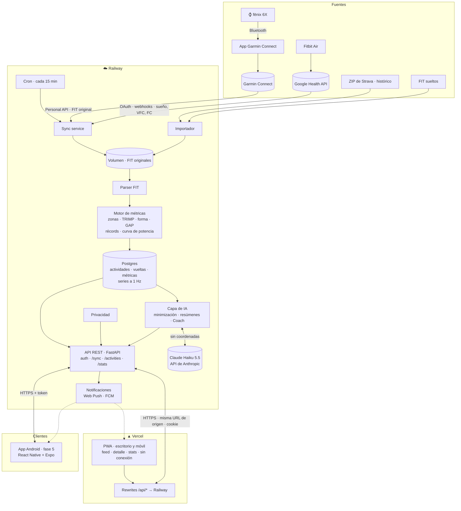
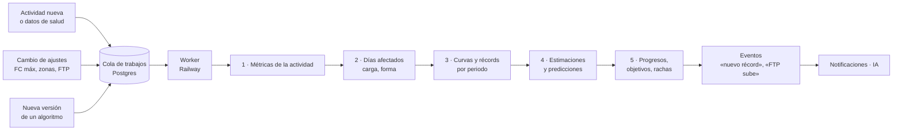
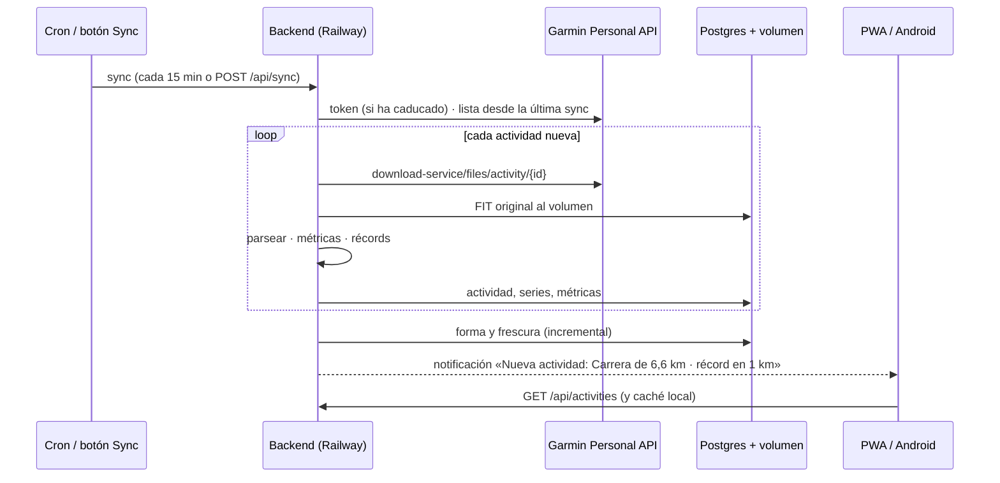

# Arquitectura de OpenSport (v1)

Una plataforma **personal** estilo Strava: sincroniza automáticamente las actividades de Garmin, guarda los FIT originales y los muestra con mapa, vueltas y **métricas avanzadas propias** (lo que Strava cobra en Premium). Hay dos clientes: primero una **PWA para escritorio y móvil, alojada en Vercel**, y después una **app Android nativa**. Los dos usan el mismo backend, que está en Railway.

Mapa visual: [arquitectura.html](arquitectura.html) · Por qué esta arquitectura: [hallazgos.md](hallazgos.md)

## Principios

1. **El FIT original es la fuente de verdad.** Se guarda tal cual y nunca se modifica. Todo lo demás se puede volver a calcular a partir de él.
2. **Primero la API.** El backend expone una API REST que comparten la PWA y la app Android. Ninguna lógica de negocio vive en los clientes.
3. **Un monorepo en TypeScript para los clientes.** La PWA (React) y la app Android (React Native + Expo) comparten un paquete `core` con el cliente de la API, los hooks de datos, la lógica de formato y los tokens de los temas.
4. **Siempre disponible.** El backend está en la nube (Railway): sincroniza solo y envía notificaciones aunque el PC esté apagado.
5. **Privado por defecto.** Un solo usuario, todo detrás de autenticación, sin perfiles públicos. Hay zonas de privacidad para lo que se comparta.
6. **Solo canales oficiales para automatizar:** la Garmin Personal API. Los ficheros manuales (ZIP de Strava, FIT sueltos) entran por un importador.
7. **Métricas propias.** Zonas, carga, forma y récords se calculan con la configuración de OpenSport, no con la del reloj.

## Diagrama



## Despliegue: Railway

| Pieza | En Railway | Notas |
|---|---|---|
| **API** | Servicio web (FastAPI + Uvicorn) | Solo API: la PWA está en Vercel. HTTPS y dominio incluidos |
| **Sync programado** | Cron Job de Railway (`*/15 * * * *`) que llama a `python -m opensport.sync` | También se lanza a mano con el botón "Sync" (`POST /api/sync`) |
| **Base de datos** | Postgres gestionado | Copias de seguridad y conexión por red privada. Las series a 1 Hz van en columnas `jsonb` o `bytea` comprimidas |
| **FIT originales** | Volumen persistente montado en `/data/raw` | Pocos MB al año (unos 50–120 KB por actividad). Se pueden copiar a otro sitio |
| **Secretos** | Variables de entorno de Railway | `GARMIN_PERSONAL_API_KEY`, `JWT_SECRET`, `VAPID_*`, `FCM_*` |

**¿Por qué Railway?** Despliega directamente desde git, ofrece Postgres, volúmenes y cron en el mismo proyecto y cuesta unos 5 $/mes para este uso.

**Alternativas:**
- **Fly.io:** parecido, con volúmenes y Postgres.
- **VPS de Hetzner:** unos 4 €/mes, con control total, pero el mantenimiento es tuyo.
- **Servidor casero en Tailscale:** los datos no salen de casa, pero depende de que el equipo esté siempre encendido.

La aplicación se empaqueta en un contenedor (Dockerfile) para poder cambiar de proveedor sin tocar código.

## Despliegue: Vercel (PWA)

| Pieza | En Vercel | Notas |
|---|---|---|
| **PWA** | Proyecto estático (build de Vite), conectado al repositorio | Cada PR tiene su URL de previsualización. Producción en el dominio principal |
| **Proxy de la API** | `vercel.json` → `rewrites: [{ "source": "/api/:path*", "destination": "https://<api>.up.railway.app/api/:path*" }]` | La PWA llama a `/api/...` en su propio origen: **sin CORS**, cookies `httpOnly` y `SameSite=Strict`, y funciona también en las previsualizaciones |
| **Variables** | `VITE_VAPID_PUBLIC_KEY` (pública) | Ningún secreto en Vercel: todos viven en Railway |

**Por qué el proxy y no llamar directamente a Railway:** si cada parte estuviera en un dominio distinto, haría falta CORS, las cookies serían entre sitios distintos (que los navegadores bloquean cada vez más) y las previsualizaciones de Vercel no tendrían un origen fijo. Con los rewrites, el navegador solo habla con Vercel.

**Coste del proxy:** Vercel limita la duración de las peticiones reenviadas, así que el progreso de la sincronización se consulta cada 2 s (`GET /api/sync/{id}`) en vez de mantener una conexión SSE abierta. La app Android habla con Railway directamente, con tokens.

**Alternativa si algún día hace falta:** dominio propio con `app.` en Vercel y `api.` en Railway. Son el mismo sitio a efectos de cookies, así que funcionaría `SameSite=Lax` con CORS restringido a `app.`.

**Lo que implica estar en la nube:** tus datos de ubicación y salud quedan en un tercero (Railway) y el servicio está expuesto a internet. Por eso la autenticación es obligatoria desde el primer día y no hay nada público por defecto.

## Componentes

| Componente | Responsabilidad | Estado |
|---|---|---|
| **Sync service** | Clave → token de 24 h → actividades nuevas → ZIP → FIT. Se lanza por cron o con el botón | ✅ Prototipo en `sync/garmin_sync.py` |
| **Importador** | FIT sueltos, ZIP de Garmin y ZIP masivo de Strava para el histórico. Evita duplicados por hora de inicio y dispositivo | Pendiente |
| **Parser FIT** | FIT → sesión, vueltas, series a 1 Hz, dispositivo y potencia | ✅ Lógica probada |
| **Motor de métricas** | Ver "Métricas avanzadas" | Parcial: mejores tiempos exactos |
| **Motor de cálculo histórico** | Cola de trabajos en Postgres y worker en Railway. Procesa el histórico de forma incremental, con recálculo completo versionado. Produce estimaciones, curvas, progresos y eventos | Pendiente |
| **API REST** | FastAPI, OpenAPI generado automáticamente. La consumen la PWA y Android | Pendiente |
| **Autenticación** | Un usuario: inicio de sesión con contraseña + TOTP, **cuenta de Google** (OpenID Connect, solo la cuenta vinculada) o passkey (WebAuthn). La PWA usa una cookie de sesión `httpOnly` (en el mismo origen, gracias al proxy de Vercel). Android usa token de acceso corto y de refresco largo. Los dispositivos se pueden revocar | Pendiente |
| **Conector de Google Health** | OAuth de Google y webhooks de la Google Health API (Fitbit Air): sueño con fases, VFC, FC en reposo, SpO₂. Reglas de prioridad entre fuentes | Fase 6 |
| **Capa de IA** | Contexto minimizado (sin coordenadas ni perfil), resúmenes por actividad, informe semanal (en lote) y Coach con herramientas sobre nuestra API | Fase 7 |
| **Notificaciones** | Web Push con VAPID para la PWA y FCM para Android: actividad nueva, récord, sincronización fallida, clave a punto de caducar | Pendiente |
| **Privacidad** | Zonas de privacidad (centro y radio) aplicadas al servir o exportar cualquier cosa compartible | Pendiente |
| **PWA** | Ver "Clientes" | Prototipo de la vista de actividad |
| **App Android** | React Native + Expo. Ver "Clientes" | Fase 5 (empieza con una prueba de concepto de rendimiento) |

## Métricas avanzadas (las "Premium" de Strava, hechas por nosotros)

| Métrica | Cálculo | Fuente de datos |
|---|---|---|
| **Zonas de FC y ritmo** | Tiempo en zonas con FC máx/reposo o umbral configurados en OpenSport (no los del reloj) | FC y velocidad a 1 Hz |
| **Esfuerzo relativo** | TRIMP de Banister (o Edwards por zonas) por actividad | FC a 1 Hz y FC de reposo/máx |
| **Forma y frescura** | Forma (CTL, media exponencial a 42 días), Fatiga (ATL, a 7 días) y Frescura (TSB = CTL − ATL) a partir del esfuerzo diario | Esfuerzo relativo |
| **Ritmo ajustado a pendiente (GAP)** | Corrección del ritmo según la pendiente (modelo de Minetti) | Altitud barométrica y distancia |
| **Récords y su evolución** | Mejores tiempos (400 m … maratón) por actividad, récord personal histórico y por temporada | Distancia acumulada |
| **Predicción de carrera** | Riegel a partir de los mejores tiempos recientes | Mejores tiempos |
| **Curva de potencia** | Mejor potencia media para cada duración (5 s … 60 min) en bici y rodillo (ROUVY) | Potencia a 1 Hz |
| **Rutas repetidas** | Agrupar actividades por similitud del recorrido y comparar tiempos (Strava "Matched Runs") | Recorrido GPS simplificado |
| **Mapa de calor personal** | Densidad de todos los recorridos | GPS de todas las actividades |
| **Volumen y tendencias** | Distancia, tiempo, desnivel y carga por semana, mes y año, por deporte | Resúmenes |
| **Datos exclusivos de Garmin** | Training Effect, carga, VFC y sueño (fase posterior) | FIT y Personal API |

Se calculan al importar cada actividad. Las métricas diarias (forma y frescura) se recalculan de forma incremental. Todo esto lo produce el motor de cálculo histórico que se describe a continuación.

## Motor de cálculo histórico ("cocinar" los datos)

Como hace Strava, OpenSport no calcula nada pesado cuando abres una pantalla. Un **motor en segundo plano procesa todo el histórico** y deja preparadas las tablas de métricas, estimaciones y progresos. Las pantallas solo leen resultados ya calculados, así que se abren al instante aunque haya miles de actividades.

### Qué produce

| Familia | Ejemplos | Cómo se estima |
|---|---|---|
| **Por actividad** | Parciales, mejores esfuerzos (distancia y duración), zonas, TRIMP, GAP, potencia normalizada, desacoplamiento FC/ritmo | De las series a 1 Hz |
| **Curvas de mejor esfuerzo** | Ritmo y potencia para cada duración (5 s … 2 h), por periodo (últimos 42 días, 90 días, temporada, histórico) | Máximos de las curvas por actividad |
| **Estimaciones de rendimiento** | FTP estimado, ritmo umbral y ritmo crítico, FC umbral (LTHR), FC máxima observada, VO₂máx estimado (VDOT), predicciones de 5K, 10K, media y maratón | FTP ≈ 95 % del mejor de 20 min o modelo de potencia crítica. Ritmo crítico con esfuerzos de 3 a 30 min. VDOT de Daniels y Riegel desde los mejores esfuerzos recientes. LTHR desde la FC media de esfuerzos de 20 a 60 min |
| **Carga y forma** | TRIMP diario, forma, fatiga y frescura, rampa semanal (riesgo de sobrecarga), monotonía | Series diarias con medias exponenciales |
| **Progresos** | Récords y su evolución, comparación con la misma semana o mes del año anterior, tendencia de las estimaciones, eficiencia aeróbica (ritmo a igual FC), rutas repetidas cada vez más rápidas | Series temporales de las tablas anteriores |
| **Objetivos y rachas** | Km o horas por semana, mes o año, rachas de semanas activas, proyección de fin de mes | Agregados por periodo |
| **Salud** (fase 6) | Tendencia de VFC, FC en reposo y sueño, «preparación» combinada con la frescura | Datos diarios de Garmin y Google Health |

Cada estimación guarda **valor, fecha, método, actividades de origen y nivel de confianza**, para poder explicar en la app de dónde sale cada cifra ("FTP estimado 205 W, a partir de tu mejor 20 min del 12 de octubre").

### Cómo funciona



- **Incremental por defecto:** una actividad nueva solo recalcula lo que depende de ella. Su propia ficha, los días desde su fecha (la forma arrastra hacia delante), las curvas de los periodos que la incluyen y las estimaciones que la usan. Unos segundos por actividad.
- **Recálculo completo en segundo plano:** cuando cambian los ajustes (FC máx, zonas, FTP) o la versión de un algoritmo, se reprocesa todo el histórico desde los FIT originales sin bloquear la app, que muestra un aviso de «recalculando».
- **Versionado:** cada tabla calculada lleva `metrics_version`. Mejorar un algoritmo es subir la versión y lanzar el recálculo, sin migraciones a mano.
- **Idempotente y reproducible:** ejecutarlo dos veces da lo mismo, y todo puede regenerarse desde los FIT originales.
- **Cola en Postgres** (sin servicios nuevos), ejecutada por un **worker** en Railway. Es el mismo contenedor que la API, arrancado en modo worker.
- **Eventos de salida:** "nuevo récord en 5K", "tu FTP estimado sube a 210 W" o "rampa de carga alta esta semana". Los consumen las notificaciones y la capa de IA.

## Gráficos

Hay tres tipos de gráficos, según cuánto se mueven y cuánto se puede interactuar con ellos:

| Tipo | Qué es | Ejemplos |
|---|---|---|
| **Estático** | Se dibuja una vez, sin animación ni interacción. Ligero, también sirve para imágenes | Miniatura del recorrido en el feed, minigráficas en las tarjetas, barra de zonas, tarjetas para compartir, imagen de la notificación |
| **Dinámico pasivo** | Se mueve sin que lo toques: anima al aparecer, se actualiza en vivo con datos nuevos y hace transiciones al cambiar de periodo o de tema | Forma y frescura tras una sincronización, anillos de objetivos, barras de volumen al cambiar de semana a mes, progreso del Sync |
| **Dinámico activo** | Responde a ti: cursor con datos al pasar por encima, zoom y selección de tramos, clic para ir al detalle, series que se activan y desactivan, cursores sincronizados entre gráficos y mapa | Perfil de la actividad (seleccionar un tramo muestra sus cifras y lo marca en el mapa), forma y frescura (clic en un día lleva a sus actividades), curvas de mejor esfuerzo comparando periodos, evolución de récords y estimaciones |

### Catálogo

| Gráfico | Pantalla | Tipo | Interacción |
|---|---|---|---|
| Miniatura del recorrido | Feed | Estático | — |
| Minigráficas de tendencia | Tarjetas y estadísticas | Estático | — |
| Barra y tabla de zonas | Detalle | Estático | — |
| Perfil (altitud + ritmo, FC, potencia, cadencia) | Detalle | Activo | Cursor sincronizado con el mapa, zoom, seleccionar un tramo (con sus cifras), activar o desactivar series |
| Mapa del recorrido | Detalle | Activo | Color por métrica, cursor sincronizado, resaltar vueltas y tramos |
| Progreso anual comparado | Estadísticas | Activo | Una línea por año, la del periodo resaltada. Cursor que compara todos los años en la misma fecha |
| Forma, fatiga y frescura | Estadísticas | Pasivo + activo | Anima al cargar y tras el Sync. Cursor por día, zoom por rango, clic → actividades del día |
| Volumen semanal, mensual y anual | Estadísticas | Pasivo + activo | Transición al cambiar de periodo. Desglose por deporte, comparación con el año anterior |
| Curvas de mejor esfuerzo (ritmo y potencia) | Estadísticas y detalle | Activo | Comparar periodos, punto → actividad de origen |
| Evolución de récords y estimaciones | Estadísticas | Activo | Cursor, clic → actividad |
| Objetivos y rachas | Inicio y estadísticas | Pasivo | Anillos y barras animados |
| Mapa de calor | Estadísticas | Activo | Zoom y filtro por deporte y periodo |
| Salud (VFC, sueño, reposo) | Salud | Pasivo + activo | Cursor, rango, comparación con la media |

### Tecnología

- **Gráficos dinámicos en la web:** **Apache ECharts**. Dibuja en canvas con reducción de puntos (LTTB), así que maneja series largas a 1 Hz sin problemas. Trae de serie el cursor con datos, el zoom (`dataZoom`), la selección de tramos (`brush`), la sincronización de cursores entre gráficos (`connect`) y las animaciones de entrada y actualización. Se le registra un tema por cada tema de OpenSport a partir de los tokens. Si alguna serie muy larga va lenta en móviles modestos, el plan B es **uPlot** solo para el perfil.
- **Gráficos estáticos:** componentes SVG propios, sin librería: ligeros, nítidos y fáciles de convertir en imagen. Las tarjetas para compartir y las imágenes de las notificaciones se generan en el servidor.
- **App móvil:** **Victory Native XL** (o ECharts para React Native), ambas dibujadas con Skia en GPU, con los colores de los tokens. El cursor y los gestos corren en el hilo de la interfaz con Reanimated.
- **Accesibilidad y rendimiento:** con `prefers-reduced-motion` se desactivan las animaciones pasivas. Cada gráfico tiene un resumen accesible (y una tabla de datos alternativa en los principales). Los gráficos fuera de pantalla no se dibujan hasta que aparecen.

## Clientes

### PWA para escritorio y móvil (en Vercel)

- **Tecnología:** TypeScript, React y Vite, con `vite-plugin-pwa` (Workbox) para el service worker y el manifiesto. TanStack Query para la caché de datos y MapLibre GL para los mapas (vectorial, fluido en móvil). Se compila a estáticos y se despliega en Vercel.
- **Diseño adaptable:**
  - **Escritorio (≥ 1024 px):** barra lateral de navegación. Feed y detalle en dos columnas (lista a la izquierda, actividad a la derecha). Mapa grande con el perfil sincronizado debajo, tablas completas de vueltas y zonas, y gráficas de forma y frescura a ancho completo.
  - **Móvil:** barra de pestañas abajo (Feed · Estadísticas · Sync · Ajustes). Detalle en una sola columna con el mapa arriba, tarjetas de métricas y gráficos que se manejan con el dedo.
  - El mismo código, con puntos de corte. Nada de versiones separadas.
- **Pantallas:** feed de actividades, detalle (mapa, perfil, vueltas, zonas, récords), estadísticas (forma y frescura, volumen, récords, curva de potencia, mapa de calor), ajustes (FC máx/reposo, zonas de privacidad, dispositivos, caducidad de la clave de Garmin) y botón "Sync" con progreso.
- **Instalable:** en escritorio (Chrome y Edge), en Android y en iOS 16.4+ ("Añadir a pantalla de inicio").
- **Temas:** claro, oscuro y estilos alternativos, sobre un sistema de **tokens de diseño** (variables CSS: fondo, superficies, texto, líneas, acento, colores por deporte y por zona, sombras, radios).
  - Cada tema es un bloque `[data-theme="…"]` que redefine los tokens. Los componentes solo usan tokens, nunca colores fijos, así que añadir un tema no toca ningún componente.
  - Temas iniciales: **Sistema** (sigue `prefers-color-scheme`), **Claro**, **Oscuro**, **Negro OLED** (negro puro, ahorra batería), **Alto contraste** (accesibilidad, también se ofrece si el sistema pide `prefers-contrast: more`), **Bosque**, **Océano** y **Atardecer**.
  - La preferencia se guarda en `localStorage`, para pintar sin parpadeo antes de cargar nada, y en los ajustes del usuario en el backend, para que te siga entre dispositivos y llegue a la app Android.
  - Mapas y gráficas también cambian: estilo vectorial claro u oscuro en MapLibre, y colores de las series tomados de los tokens. `theme-color` y `color-scheme` se actualizan para la barra del navegador y los controles nativos.
  - Cada tema pasa una comprobación de contraste WCAG AA (texto ≥ 4,5:1) en CI.
- **Sin conexión:** el service worker guarda la app. Las actividades vistas y su serie a 1 Hz se guardan en IndexedDB, y las teselas del mapa ya vistas quedan en caché.
- **Notificaciones:** Web Push en escritorio (Chrome, Edge, Firefox) y en Android. En iOS solo si la PWA está instalada.

### App Android (fase 5): React Native + Expo

- **Por qué React Native y no Kotlin:** comparte con la PWA el lenguaje (TypeScript), React, el cliente de la API, los hooks de datos, la lógica de dominio y los tokens. Lo hace una sola persona con un solo stack, y deja iOS casi gratis. La nueva arquitectura de React Native (Fabric, JSI, Hermes) da un rendimiento prácticamente igual al nativo en este tipo de app: el cálculo pesado lo hace el backend, y los mapas y gráficos se dibujan en nativo o en GPU.
- **Tecnología:**
  - Expo (SDK actual, arquitectura nueva) con Expo Router, compilación en EAS y actualizaciones OTA para cambios de JavaScript.
  - Mapas con `@maplibre/maplibre-react-native` (el mismo motor que la web).
  - Gráficos con Skia (Victory Native XL), y gestos y animaciones con Reanimated y Gesture Handler.
  - Listas con FlashList.
  - Sin conexión con la caché persistente de TanStack Query y `expo-sqlite`.
  - Sincronización en segundo plano con `expo-background-task` (WorkManager por debajo).
  - Notificaciones con FCM (`expo-notifications`).
  - Health Connect con `react-native-health-connect`.
  - **Acceso:** Google nativo (`@react-native-google-signin/google-signin`, Credential Manager), contraseña + TOTP o passkey (`react-native-passkey`, la misma que en la web gracias a `assetlinks.json`).
  - **Desbloqueo con huella:** el token de refresco se guarda en `expo-secure-store` protegido por biometría fuerte (`expo-local-authentication`). En muchos Samsung el reconocimiento facial es biometría débil y no sirve para liberar claves, así que allí se usa la huella.
- **Temas:** los mismos tokens que la PWA, desde la fuente única de `packages/core`, más el color dinámico de Android (Material You) mediante un módulo pequeño.
- **Lo único que toca nativo:** el widget de pantalla de inicio (con `react-native-android-widget` o un módulo de Expo en Kotlin).
- **Rendimiento:** la pantalla exigente es el detalle de actividad (arrastrar por el perfil con el cursor sincronizado en el mapa). Se valida con una **prueba de concepto** al empezar la fase. Criterios: arranque en frío por debajo de 1,5 s, 60 fps al arrastrar y memoria razonable en un móvil de gama media. Si no se cumplen, el plan B es Kotlin, habiendo perdido solo esos días.
- **Ventajas sobre la PWA:** notificaciones y sincronización más fiables, widget, Health Connect, y la puerta abierta a iOS o a grabar con el GPS del móvil.

### Estructura del monorepo

```
backend/            Python · FastAPI · motor de cálculo (Railway)
apps/web/           PWA · React + Vite (Vercel)
apps/mobile/        App · React Native + Expo (EAS)
packages/core/      TypeScript compartido: cliente de la API generado desde OpenAPI, hooks de TanStack Query,
                    formato y dominio (ritmos, zonas, duraciones), tokens de diseño → CSS y tema de React Native
docs/  tools/
```

Lo compartido es la lógica, no los componentes visuales: la web usa el DOM (ECharts, MapLibre GL JS) y el móvil componentes nativos (Skia, MapLibre nativo). No se usa React Native Web.

## Fuentes de salud: Google Health API (Fitbit Air)

- **Qué es:** la API que Google lanzó en mayo de 2026 junto con la Fitbit Air. Sustituye a la antigua Fitbit Web API, que dejó de funcionar el 2 de noviembre de 2026. Ofrece unos 31 tipos de datos, entre ellos sueño con fases, FC, VFC, SpO₂ y respiración, y webhooks que avisan cuando hay datos nuevos.
- **Acceso:** proyecto en Google Cloud con OAuth 2.0 y permisos de solo lectura mínimos. Los tokens se guardan cifrados en Postgres.
- **A comprobar antes de construir:** en modo «Testing» las apps OAuth de Google emiten tokens de refresco que caducan a los 7 días, y los permisos de salud pueden exigir la verificación de Google. Si no es viable para uso personal, la alternativa es leer **Health Connect** desde la app Android (fase 5), donde la app de Google Health también escribe.
- **Varias fuentes:** cada dato guarda su fuente. Unas reglas de prioridad configurables deciden qué se muestra cuando Garmin y Fitbit miden lo mismo (por ejemplo, el sueño de la Fitbit Air y las actividades de Garmin).

## Capa de IA (LLM pequeño vía API)

- **Modelo:** **Claude Haiku 5.5** (`claude-haiku-5-5`) con el SDK oficial de Python `anthropic`. Cuesta 0,10 $ por millón de tokens de entrada y 0,50 $ por millón de salida (hasta 100K tokens de prompt). Un resumen de actividad (unos 3K tokens de entrada y 300 de salida) cuesta unos 0,0005 $: **céntimos al mes** para un usuario.
- **Usos:**
  1. **Resumen al importar cada actividad**, con salida estructurada (`output_config.format`).
  2. **Informe semanal** con la Batch API, a mitad de precio porque no hace falta inmediatez.
  3. **Coach**: preguntas en lenguaje natural. El modelo usa herramientas (`buscar_actividades`, `estadisticas_forma`, `records`, `salud_diaria`) que consultan nuestra API, en vez de recibir todo el historial. Respuesta en streaming.
- **Coste bajo control:** prompt de sistema y herramientas estables para aprovechar la caché de prompts, registro de tokens por llamada y límite mensual de gasto.
- **Privacidad:** el LLM **nunca recibe coordenadas, recorridos ni datos de perfil**, solo cifras agregadas. Hay un interruptor general «usar IA» y la pantalla de ajustes explica qué se envía. Las condiciones de retención y uso de datos del proveedor hay que revisarlas al activar la cuenta.
- **Que no se invente cifras:** las respuestas citan datos devueltos por las herramientas, y un conjunto de evaluación comprueba que las cifras coinciden con la base de datos antes de cambiar el prompt o el modelo. Si algún análisis necesita más capacidad, se puede probar a subir solo esa ruta a un modelo mayor, midiéndolo con esa misma evaluación.

## Modelo de datos (Postgres)

```
activities    id (Garmin activityId) · source · name · sport · sub_sport · start_utc · tz
              duration_s · moving_s · distance_m · ascent_m · descent_m · avg_hr · max_hr
              calories · training_effect · trimp · device · fit_path · fit_sha256
              has_gps · bbox · route_simplified (polilínea) · raw_meta jsonb · imported_at
streams       activity_id · series (lat, lon, dist, alt, hr, cad, speed, power, temp) comprimidas
laps          activity_id · idx · start_utc · duration_s · distance_m · avg_hr · max_hr · ascent_m
best_efforts  activity_id · distance_m · time_s · start_offset_m
power_curve   activity_id · duration_s · watts
zone_time     activity_id · kind (hr|pace|power) · zone · seconds
daily_load    date · trimp · ctl · atl · tsb
route_groups  id · activities[] · representative_route
sleep_sessions  id · source · start_utc · end_utc · stages jsonb · score · external_id
daily_health  date · source · resting_hr · hrv · spo2 · resp_rate · steps · external_id
sources       id · kind (garmin|google_health|strava|file) · credentials_enc · last_sync · priority
jobs          id · kind · payload jsonb · status · run_after · attempts · error   ← cola del motor de cálculo
effort_curves activity_id | period · sport · kind (pace|power|hr) · duration_s · value · metrics_version
estimates     date · kind (ftp|threshold_pace|critical_pace|lthr|hr_max|vdot|race_5k…) · value · method · confidence · source_activities[] · metrics_version
progress      period · metric · value · prev_value · goal · metrics_version
events        id · kind (pr|estimate_up|ramp_warning…) · payload · created_at · notified
llm_calls     id · purpose (summary|weekly|coach) · model · input_tokens · output_tokens · cost_usd · created_at
settings      hr_max · hr_rest · lthr · ftp · zone_model · privacy_zones · units
auth_methods  id · kind (password_totp|google|passkey) · google_sub · email · credential_id · created_at · last_used
devices       id · name · platform (web|android) · push_endpoint · refresh_token_hash · last_seen
sync_runs     id · trigger (cron|button) · started_at · finished_at · new_count · status · error
```

## API REST

| Método | Ruta | Descripción |
|---|---|---|
| `POST` | `/api/auth/login` · `/refresh` · `/logout` | Sesión con token de acceso y de refresco |
| `GET` | `/api/auth/google/start` · `/api/auth/google/callback` | Acceso con Google en la web (OIDC con PKCE). Solo entra el `sub` vinculado |
| `POST` | `/api/auth/google/mobile` | Acceso con Google desde la app: recibe el token de identidad del SDK nativo y aplica la misma regla |
| `POST` | `/api/auth/passkey/register` · `/api/auth/passkey/login` | Passkeys (WebAuthn), comunes a la PWA y a la app |
| `GET` | `/.well-known/assetlinks.json` | Enlaza la app Android con el dominio, para compartir passkeys (servido desde Vercel) |
| `POST/DELETE` | `/api/auth/google/link` | Vincular o desvincular la cuenta de Google (requiere otro método activo) |
| `POST` | `/api/sync` | Lanza la sincronización y devuelve `sync_run_id` |
| `GET` | `/api/sync/{id}` | Estado y progreso (la PWA lo consulta cada 2 s a través del proxy de Vercel) |
| `GET` | `/api/activities?sport=&from=&to=&q=&cursor=` | Feed paginado, filtrado por periodo, deporte y texto |
| `GET` | `/api/activities/{id}` | Resumen, vueltas, récords, zonas y esfuerzo |
| `GET` | `/api/activities/{id}/streams` | Series a 1 Hz (gzip), con zonas de privacidad aplicadas |
| `GET` | `/api/activities/{id}/fit` | Descarga el FIT original |
| `GET` | `/api/stats/fitness?from=&to=` | Forma, fatiga y frescura |
| `GET` | `/api/stats/summary?from=&to=&compare=prev_year` | Totales del periodo y del mismo periodo del año anterior |
| `GET` | `/api/stats/progress?sport=` | Distancia acumulada por día del año, por año |
| `GET` | `/api/stats/records` · `/volume` · `/power-curve` · `/heatmap` | Estadísticas |
| `POST` | `/api/import` | Sube FIT o ZIP |
| `GET/PUT` | `/api/settings` | FC, umbrales, zonas de privacidad |
| `POST/DELETE` | `/api/devices` | Registrar o revocar un dispositivo y su endpoint de notificaciones |

## Flujo de sincronización



## Riesgos

| Riesgo | Mitigación |
|---|---|
| Garmin cambia o limita la Personal API | Los FIT ya guardados no se pierden. El importador manual y el USB siguen como plan B |
| La clave caduca (máximo 1 año) | Notificación 2 semanas antes y aviso en ajustes |
| Límites de uso no publicados | Sincronización incremental cada 15 min, una petición cada vez, reintentos ante 429 |
| Datos sensibles en un tercero | Autenticación fuerte, nada público, zonas de privacidad, copias de seguridad cifradas que puedes descargar |
| Dependencia de Railway | Contenedor estándar, Postgres estándar y FIT en ficheros: migrar a Fly.io o a un VPS es redesplegar |
| Google OAuth en modo «Testing» (tokens de 7 días) y verificación de permisos de salud | Comprobarlo al empezar la fase 6. Alternativa: Health Connect desde Android |
| El LLM se inventa cifras o recibe datos de más | Herramientas sobre datos reales, evaluación de cifras, minimización sin coordenadas, interruptor «usar IA» |
| Notificaciones de la PWA poco fiables | La app Android con FCM lo resuelve en la fase 5 |
| Rendimiento de React Native en el detalle de actividad | Prueba de concepto al inicio de la fase 5 con criterios medibles. Plan B: Kotlin |
| Actualizaciones de React Native o Expo que rompen dependencias | Seguir el SDK de Expo, pocas librerías nativas y bien mantenidas, actualizar una vez por versión de Expo |
| Límites del proxy de Vercel (duración, tamaño) | Respuestas pequeñas y paginadas, series comprimidas, progreso consultado cada 2 s en lugar de SSE. Si se queda corto: subdominio `api.` directo a Railway |
| Dos plataformas que coordinar | La URL de Railway en un solo sitio (`vercel.json`). La PWA no tiene secretos. El cliente de la API se genera desde OpenAPI |

## Fases

Detalle con tickets, dependencias y criterios de terminado: [roadmap.md](roadmap.md). La fase 0 (fundaciones: repositorio, CI, Railway y Vercel) va antes de todas.

1. **Backend en Railway:** paquete `opensport` (sync, parser, métricas básicas), Postgres, volumen, autenticación, API de actividades y cron.
2. **PWA en Vercel:** escritorio y móvil, feed, detalle a partir del prototipo, botón Sync con progreso, instalable y sin conexión.
3. **Métricas avanzadas:** zonas propias, esfuerzo relativo, forma y frescura, GAP, récords, curva de potencia, rutas repetidas, mapa de calor.
4. **Avisos, histórico y privacidad:** Web Push, importación del ZIP de Strava, zonas de privacidad en el servidor y compartir actividades.
5. **App Android:** React Native + Expo sobre `packages/core`. Empieza con una prueba de concepto de rendimiento.
6. **Salud multifuente:** sueño, VFC y datos diarios de Garmin y Google Health (Fitbit Air), con reglas de prioridad, y Health Connect en Android.
7. **Asistente con IA:** resúmenes, informe semanal y Coach con Claude Haiku 5.5, con datos minimizados.
